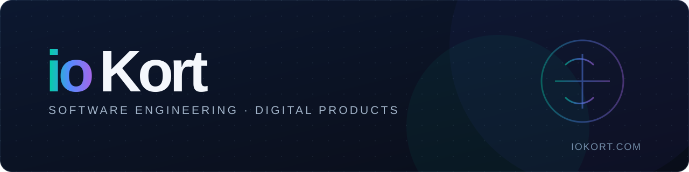

### ONE DEV COMPANY

**Independent software engineering · Mobile, web & backend · Built with purpose**

[Website](https://iokort.com) · [Repositories](https://github.com/orgs/iokort/repositories?q=visibility%3Apublic) · [Selected work](https://github.com/iokort/Follow-Motors)

---

## Software that solves real problems

**ioKort** is an independent software development brand building purposeful digital products. We create applications, services and interfaces with an emphasis on **performance, maintainability, accessibility and clean user experiences**.

We prefer working solutions over unnecessary complexity, architecture that serves real requirements and improvements that can be verified.

## What we build

| Area | Focus |
|:--|:--|
| **Mobile applications** | Multiplatform experiences with Flutter and Dart |
| **APIs & backend** | Services, business logic and integrations with C# and .NET |
| **Web platforms** | Responsive applications with Angular, TypeScript and JavaScript |
| **Data & infrastructure** | MySQL, automation, GitHub workflows and deployments |

## Selected public work

### [Follow Motors](https://github.com/iokort/Follow-Motors)

An application engineering project connecting web interfaces, backend services and structured data management.

Some projects remain private while in development or because of institutional and client requirements.

## Engineering principles

- **Build what matters.** Understand the real problem before introducing complexity.
- **Keep responsibilities clear.** Prefer focused, maintainable changes and deliberate architecture.
- **Respect the platform.** Use native capabilities when they meet the requirements.
- **Deliver verifiable work.** Separate implementation, testing and release readiness.

---

**[Explore ioKort](https://iokort.com)** · **[Browse public repositories](https://github.com/orgs/iokort/repositories?q=visibility%3Apublic)**

© 2026 ioKort · Software built with purpose.

